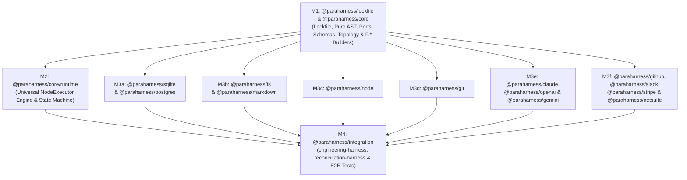

# ParaHarness (`@paraharness/*`) — Master Implementation Plan Index

This directory contains the self-contained milestone plans for building and verifying the ParaHarness TypeScript monorepo (`@paraharness/*`) against [`docs/SPEC.md`](file:///Users/torniketsomaia/projects/metaharness/docs/SPEC.md) (`lines 1–3324`), [`docs/CODING_SAMPLE.md`](file:///Users/torniketsomaia/projects/metaharness/docs/CODING_SAMPLE.md) (`lines 1–1208`), [`CLAUDE.MD`](file:///Users/torniketsomaia/projects/metaharness/CLAUDE.MD), and [`docs/CODING_GUIDELINES.md`](file:///Users/torniketsomaia/projects/metaharness/docs/CODING_GUIDELINES.md) (§§1–6).

Each milestone file is designed to be handed directly to an isolated **Builder Subagent** (and verified by **Reviewer** and **Verifier** subagents) with bounded context reads: a subagent only needs its mandatory Turn-1 bootstrap manifest (`CLAUDE.MD`, `docs/rules/{GENERAL,BUILDER}.md`, `docs/lessons/{GENERAL,BUILDER}.md`, `docs/CODING_GUIDELINES.md`), its single assigned `docs/plan/M*.md` file, and the exact `docs/SPEC.md` / `docs/CODING_SAMPLE.md` line ranges cited in §2 of that milestone file.

---

## 1. Package Topology & Dependency Graph

Every adapter package (`@paraharness/sqlite`, `@paraharness/postgres`, `@paraharness/fs`, `@paraharness/markdown`, `@paraharness/node`, `@paraharness/git`, `@paraharness/claude`, `@paraharness/openai`, `@paraharness/gemini`, `@paraharness/github`, `@paraharness/slack`, `@paraharness/stripe`, `@paraharness/netsuite`) depends on `@paraharness/core` (`workspace:*`) (with `@paraharness/fs` and `@paraharness/git` also consuming the standalone `@paraharness/lockfile` utility package). Cross-adapter imports are strictly forbidden (`docs/SPEC.md` §1.1, `docs/CODING_SAMPLE.md` §2).

---

## 2. Milestone Execution Topology: `(b) -> (c) -> (b)`

### Wave 1a — Sequential Core Contracts (`M1`, Topology `b`)
- **[M1-core-contracts.md](./M1-core-contracts.md)**: Bootstraps workspace manifests, builds `@paraharness/lockfile` (`packages/lockfile/{src,test}/**`), and builds `@paraharness/core` (`packages/core/src/{ast,ports,schemas,topology,builders}/**`, `packages/core/src/p-namespace-contract.ts`, `packages/core/src/p-namespace.ts`, `packages/core/src/index.ts`, and initial `packages/core/src/runtime/index.ts`):
  - Standalone cross-process advisory lockfile utility (`@paraharness/lockfile` exporting `withFileLock` and `FileLockOptions` with `p-queue` per-path in-process serialization, atomic `open(lockPath, 'wx')`, `.unref()`ed `utimes` heartbeat, and dead-PID / stale-`mtime` reclamation).
  - Pure passive discriminated-union AST foundation (`ASTNode`, `AstBuilder<TNode>`, `MaybeBuilder<TNode>`, `extractAST`, `EnvRef`, `CoreASTNode`, `DomainASTNode`, `CustomDomainASTRegistry`, and all base/domain AST interfaces from `SPEC.md` §§2.1–2.2 & §§4.1–4.5).
  - Universal `NodeExecutor`, `RuntimeExecutorRegistry`, `createExecutorRegistry`, `IsolationScope` (`'scope'`), `CheckpointableScope` (`'checkpointable'`), `BranchableScope` (`'branchable'`), `ModelDriver`, `LedgerStore`, `TopologyStore`, `LessonStore`, `TrackerAdapter`, `StreamSource`, `HumanAdapter`, and `ControlPlaneAdapter` ports (`SPEC.md` §§2.3–2.8).
  - Schemas (`ScopePredicateSchema`, `GlobalRuleSchema`, `ScopedRuleSchema`, `BudgetApprovalSchema`, `ResumeForkInputSchema`, `SpeculationCandidateSchema`, `SpeculationInputSchema`, `zodToJsonSchema` via `zod` v4 `z.toJSONSchema()`) and topology DAG queries (`dependentsOf`, `affectedBy` via `@dagrejs/graphlib`).
  - All fluent `P.*` builders (`P.env`, `P.signal`, `P.interrupt`, `P.stream`, `P.pool`, `P.prefixGroup`, `P.topology`, `P.rules`, `P.scopedRule`, `P.skill`, `P.lessons`, `P.policy`, `P.human`, `P.command`, `P.agent`, `P.loop`, `P.flow`, `P.lane`, `P.harness`) with static build-time validation of `capabilityTier`, `effectTracking`, `interactionMode`, `.withTools()` canonical `roleKey` derivation, and `.withPolicy()` interrupt handler preservation.

### Wave 1b — Sequential Core Runtime Engine (`M2`, Topology `b`)
- **[M2-core-runtime.md](./M2-core-runtime.md)**: Builds `@paraharness/core/runtime` (`packages/core/src/runtime/**`, `packages/core/src/runtime/index.ts`, `packages/core/test/runtime-*.test.ts`, and runtime re-exports in `packages/core/src/index.ts`) once M1 passes its gate:
  - `ScopeLockManager` (shared-read vs exclusive-write handle locks), `StepContinuationQueue` (per-`stepExecId` FIFO serialization), `PoolManager` (run-sticky seat affinity, `429` failover, `escalate-on-retry`), and `ServiceSessionRegistry` (reference-counted daemons across `activeSkillIds`, step-boundary quiescing, pre-drain re-acquisition with `[SERVICE_REACQUIRED]`).
  - Run-immutable `CompiledWirePrefix` compilation, in-run `updatedGroundingDiffs`, Turn-0 `[ROLE_AND_SCOPE_CONTEXT]` frames, and `P.lessons` scoring/distillation/retirement.
  - Two-phase policy guard evaluation (`'deny-with-error'` before `'raise-interrupt'`, multi-call pre-flight batching, post-flight `effectTracking: 'subprocess-post-flight'` sandboxing with `inFlightPreToolCheckpoint` rollback, declaration-ordered `remainingCalls` replay, nested `.adjudicateWith()` outer lease attachment, and 4-step `.onLimitExceeded()` epistemic flush).
  - `executeAgent`, `executeLoop`, `executeCommand`, `executeStepNode`, `executeFlow`, `LaneScheduler`, and `createRuntime`: downward `.fork()` (with conflict-bounce retry loop), speculative `.speculate()` (Post-Race Cases 1–4, `PARKED_ON_ESCALATION`, `refineWinnerWhen`, non-destructive `unpark-escalation`), dynamic `.mutatePlan()` (linear prerequisite chaining, `suspend-and-yield-slot`, replay-idempotent `syncRoot`), and upward `.onChildInterrupt()` + `resumeFork` (Cases A/B/C and recursive epoch resolution).

### Wave 2 — Parallel Adapter Fan-Out (`M3a`–`M3f`, Topology `c`)
All 6 adapter milestones depend **only** on `@paraharness/core` from M1 and touch strictly disjoint `packages/<adapter>/**` directories:
- **[M3a-sqlite.md](./M3a-sqlite.md)**: `@paraharness/sqlite` (`packages/sqlite/**`) and `@paraharness/postgres` (`packages/postgres/**`).
- **[M3b-fs-markdown.md](./M3b-fs-markdown.md)**: `@paraharness/fs` (`packages/fs/**`) and `@paraharness/markdown` (`packages/markdown/**`).
- **[M3c-node.md](./M3c-node.md)**: `@paraharness/node` (`packages/node/**`).
- **[M3d-git.md](./M3d-git.md)**: `@paraharness/git` (`packages/git/**`).
- **[M3e-drivers.md](./M3e-drivers.md)**: `@paraharness/claude` (`packages/claude/**`), `@paraharness/openai` (`packages/openai/**`), and `@paraharness/gemini` (`packages/gemini/**`).
- **[M3f-connectors.md](./M3f-connectors.md)**: `@paraharness/github` (`packages/github/**`), `@paraharness/slack` (`packages/slack/**`), `@paraharness/stripe` (`packages/stripe/**`), and `@paraharness/netsuite` (`packages/netsuite/**`).

### Wave 3 — End-to-End Reference Harnesses & Integration Verification (`M4`, Topology `b`)
- **[M4-integration.md](./M4-integration.md)**: Builds `@paraharness/integration` (`packages/integration/**`), compiling and testing both the complete `engineering-harness` reference implementation (`CODING_SAMPLE.md` §6) and the non-coding financial `reconciliation-harness` (`SPEC.md` §5) end-to-end across all `@paraharness/*` packages.

---

## 3. File & Directory Ownership Matrix

| Milestone | Owned Directories (`owned_dirs` — Read/Write) | Forbidden Directories (`forbidden_dirs` — Zero Touch) |
| :--- | :--- | :--- |
| **M1** | `pnpm-workspace.yaml`, `packages/*/{package.json,tsconfig.json}`, `packages/lockfile/**`, `packages/core/src/{ast,ports,schemas,topology,builders}/**`, `packages/core/src/p-namespace-contract.ts`, `packages/core/src/p-namespace.ts`, `packages/core/src/index.ts`, `packages/core/src/runtime/index.ts`, `packages/core/test/{fixtures,ast-and-schemas.test.ts,topology-and-builders.test.ts,flow-and-validation.test.ts}` | `packages/core/src/runtime/**` (except `runtime/index.ts`), `packages/{sqlite,postgres,fs,markdown,node,git,claude,openai,gemini,github,slack,stripe,netsuite,integration}/{src,test}/**`, `package.json`, `eslint.config.mjs`, `tsconfig.base.json`, `vitest.config.ts`, `.agents/**`, `.claude/**`, `docs/**` |
| **M2** | `packages/core/src/runtime/**`, `packages/core/src/runtime/index.ts`, `packages/core/src/index.ts` (runtime re-exports), `packages/core/test/fixtures/**`, `packages/core/test/runtime-*.test.ts` (5 subsystem test files) | `packages/core/src/{ast,ports,schemas,topology,builders}/**`, `packages/core/src/p-namespace*.ts`, all adapter packages, `packages/integration/**`, root configs, `.agents/**`, `.claude/**`, `docs/**` |
| **M3a** | `packages/sqlite/{src,test}/**`, `packages/postgres/{src,test}/**` | `packages/core/**`, all other `packages/*/**`, root configs, `.agents/**`, `.claude/**`, `docs/**` |
| **M3b** | `packages/fs/{src,test}/**`, `packages/markdown/{src,test}/**` | `packages/core/**`, all other `packages/*/**`, root configs, `.agents/**`, `.claude/**`, `docs/**` |
| **M3c** | `packages/node/{src,test}/**` | `packages/core/**`, all other `packages/*/**`, root configs, `.agents/**`, `.claude/**`, `docs/**` |
| **M3d** | `packages/git/{src,test}/**` | `packages/core/**`, all other `packages/*/**`, root configs, `.agents/**`, `.claude/**`, `docs/**` |
| **M3e** | `packages/claude/{src,test}/**`, `packages/openai/{src,test}/**`, `packages/gemini/{src,test}/**` | `packages/core/**`, all other `packages/*/**`, root configs, `.agents/**`, `.claude/**`, `docs/**` |
| **M3f** | `packages/github/{src,test}/**`, `packages/slack/{src,test}/**`, `packages/stripe/{src,test}/**`, `packages/netsuite/{src,test}/**` | `packages/core/**`, all other `packages/*/**`, root configs, `.agents/**`, `.claude/**`, `docs/**` |
| **M4** | `packages/integration/{src,test}/**` | `packages/core/**`, all adapter `packages/*/**`, root configs, `.agents/**`, `.claude/**`, `docs/**` |

---

## 4. Global Invariants for All Subagents

1. **Pure AST & Late Binding (`docs/SPEC.md` §1.1–§1.2, `docs/CODING_GUIDELINES.md` Rule 5.2):**
   - Every builder method and `.toAST()` call must be 100% side-effect-free (zero filesystem, network, subprocess, or database I/O at import or builder time) and return deeply frozen (`Object.freeze`) monomorphic AST objects (`docs/CODING_GUIDELINES.md` Rule 4.3).
2. **Explicit Capabilities & Symbolic `EnvRef` (`docs/SPEC.md` §1.2, `docs/CODING_GUIDELINES.md` Rule 5.2):**
   - Never read `.env` or evaluate `process.env` at module import or builder time. Secrets and environment-dependent values are represented symbolically via `P.env('KEY')` (`EnvRef`) in AST definitions and resolved exclusively at leaf adapter execution time via `ctx.resolveEnv`.
3. **Single-Kind Module Organization & Natural Phase Decomposition (`docs/CODING_GUIDELINES.md` §1 & Rule 3.3):**
   - **Single-kind entity files (`Rule 1.1`):** Unrelated or different-kind declarations (`interface`, `type`, `class`, `function`, `const`) must **never** share a production file (`src/**`, `test/fixtures/**`), enforced by `harness/file-separation` (Rules 1.2–1.7):
     1. **`*.types.ts`**: pure `type` aliases (discriminated unions, primitive/template-literal/mapped/conditional types);
     2. **`*.schema.ts`**: Zod schema `export const FooSchema = z.object(...)` paired with its inferred `export type Foo = z.infer<typeof FooSchema>`;
     3. **`<entity-name>.ts` (`Rule 1.2`)**: 1 root `interface` + secondary sub-interfaces reachable from the root interface via **`TSPropertySignature`, `TSIndexSignature`, `extends`, or `TSMethodSignature` parameter/return types** (such as fluent callback sub-builders `$d`, `$r`, `$t`, `$f`, `$s`, `$intr`, `$b`, `$c`, `$m`, `$l` and dedicated port method parameter/return interfaces);
     4. **`<class-name>.ts` (`Rule 1.3`)**: 1 `class` with a single stateful responsibility + optional dedicated 1:1 `*Params` / `*Options` parameter interfaces (and their reachable sub-interfaces);
     5. **`create-*-builder.ts` / `<domain-verb>.ts` / `internal/<domain-verb>.ts` (`Rule 1.6` & `Rule 3.3`)**: focused single-responsibility functions + optional dedicated 1:1 `*Params` / `*Options` parameter interfaces (and their reachable sub-interfaces; shared multi-caller `*Params` / `*Options` interfaces live in their own dedicated interface file). Builders are free and expected to extract additional `internal/` phase, predicate, and projection helper files beyond the §3 baseline tables whenever responsibilities separate;
     6. **`*.constants.ts` & `index.ts` (`Rules 1.5 & 1.7`)**: `const` values only in `*.constants.ts` (and namespace facade `const` in `*-namespace.ts` separated from its `*-namespace-contract.ts` interface); pure explicit re-exports in `index.ts` (zero declarations and zero wildcard `export *`).
   - **Strict DAG imports & 1:1 naming (`Rules 1.7 & 1.8`):** Leaf files import directly from sibling leaf files (never back through `index.js`), and grab-bag file names (`utils.ts`, `helpers.ts`, `common.ts`, `shared.ts`, `misc.ts`, `core.ts`, `base.ts`, unprefixed `types.ts` / `constants.ts` / `schemas.ts`) are forbidden.
4. **Mandatory JSDoc Anatomy & Zero Inline Comments (`CLAUDE.MD`, `docs/CODING_GUIDELINES.md` §2):**
   - **Every declaration documented (`Rule 2.1`):** Every `class` (and its constructor, methods, and properties), `interface` (and its properties and methods), `function` (public, `internal/`, and CLI hook/script functions), and top-level `type` alias or `const` in `src/**`, `test/fixtures/**`, `scripts/**`, `.agents/hooks/**`, and `eslint.config.mjs` requires a `/** ... */` JSDoc block immediately above its declaration.
   - **JSDoc tag completeness (`Rules 2.2–2.3`):** Every documented declaration requires a clear summary sentence (plus behavioral invariants, state transitions, edge cases, or concurrency guarantees when non-obvious) and complete `@template TName Description`, `@param {Type} name - Description` (`[name=default]` when optional), `@returns {Type} Description` (for non-`void` callables), and `@throws {ErrorType} Description` tags, written in direct engineering English without stub tautologies or filler.
   - **Zero inline or non-JSDoc comments (`Rule 2.4`):** Write **zero inline or non-JSDoc comments** (single-line slash comments, non-JSDoc block comments, hash comments, or HTML comments) in any file, and **zero comments of any kind** inside a function, method, or constructor body.
5. **Single Responsibility, Library-First Mandate, Runtime Performance & Type Rigor (`docs/CODING_GUIDELINES.md` §§3–5):**
   - Every function, method, and class must do **one thing at one level of abstraction** (`Rule 3.1`) with flat guard clauses (`Rule 3.2`, max nesting depth `3`) and named `*Params` / `*Options` parameter objects whenever a function/method/constructor takes `> 3` parameters (`Rule 3.3`). Orchestrators only sequence named phase calls and lifecycle boundaries (`try / finally`); never mix high-level orchestration with inline context casting, state-object assembly, scoring math, raw I/O, or loop-body details.
   - Enforce the **Library-First Mandate (`Rule 3.5`)**: use the exact Owner-approved libraries mandated in `docs/CODING_GUIDELINES.md` Rule 3.5 and each milestone's §1 **Approved External Libraries & Native Primitives** table rather than hand-rolling commodity utilities.
   - Use single-pass `for` loops (zero array/object spread accumulation in loops, zero `.filter().map().flatMap()` chains in runtime paths) and pre-indexed `Map` / `Set` $O(1)$ lookups; pre-compile `picomatch` globs and `RegExp` instances once at registration (`Rules 4.1–4.4`).
   - Release all acquired resources (leases, worktrees, daemons, child processes, DB transactions, `AbortSignal` listeners) inside `try / finally` (`Rule 5.3`).
   - Zero `: any`, `as any`, `as unknown as T`, unguarded `!` non-null assertions, or `@ts-ignore` / `@ts-expect-error` / `@ts-nocheck` directives in `src/**` or `test/**` (`Rule 5.1`).
6. **Real-Resource Deterministic Testing (`docs/CODING_GUIDELINES.md` §6):**
   - Organize tests per subsystem (`test/*.test.ts`), placing shared fakes/fixtures in `test/fixtures/` (obeying single-entity-kind file separation and §2 JSDoc).
   - Test against real local SQLite databases, real `PGlite` PostgreSQL instances, real Git repositories/worktrees, real temporary directories, and real Node child processes/PTY daemons; coordinate concurrency with deterministic barrier latches (zero `setTimeout` sleeps) and assert exact structural outputs and error messages.

---

## 5. Milestone Summary & Scoped Gate Commands

Every milestone gate runs its scoped `lint`, `typecheck`, and `vitest` commands (and `pnpm lint && pnpm typecheck && pnpm test` at wave barriers) plus `test -z "$(git status --porcelain -- docs .agents .claude package.json tsconfig.base.json vitest.config.ts)"` (along with the `docs/IMPL_LOOP.md` `baseline_dirty` check verifying zero new or newly modified files in `<non_sibling_forbidden_dirs_excluding_upstream_patches>` relative to `baseline_dirty` so uncommitted `M1`/`M2` files and concurrent Wave-2 sibling adapters never cause false gate failures).

| Milestone | Plan File | Target Packages | Scoped Verification Gate Commands |
| :--- | :--- | :--- | :--- |
| **M1** | [`docs/plan/M1-core-contracts.md`](./M1-core-contracts.md) | `@paraharness/lockfile`, `@paraharness/core` *(Lockfile, Pure AST, Ports, Schemas, Topology & `P.*` Builders)* | `pnpm --filter @paraharness/lockfile --filter @paraharness/core lint && pnpm --filter @paraharness/lockfile --filter @paraharness/core typecheck && pnpm --filter @paraharness/lockfile --filter @paraharness/core test -- --reporter=verbose && test -z "$(git status --porcelain -- docs .agents .claude package.json tsconfig.base.json vitest.config.ts)"` |
| **M2** | [`docs/plan/M2-core-runtime.md`](./M2-core-runtime.md) | `@paraharness/core` *(Runtime Engine & State Machine)* | `pnpm --filter @paraharness/core lint && pnpm --filter @paraharness/core typecheck && pnpm --filter @paraharness/core test -- --reporter=verbose && test -z "$(git status --porcelain -- docs .agents .claude package.json tsconfig.base.json vitest.config.ts)"` |
| **M3a** | [`docs/plan/M3a-sqlite.md`](./M3a-sqlite.md) | `@paraharness/sqlite`, `@paraharness/postgres` | `pnpm --filter @paraharness/sqlite --filter @paraharness/postgres lint && pnpm --filter @paraharness/sqlite --filter @paraharness/postgres typecheck && pnpm --filter @paraharness/sqlite --filter @paraharness/postgres test -- --reporter=verbose && test -z "$(git status --porcelain -- docs .agents .claude package.json tsconfig.base.json vitest.config.ts)"` |
| **M3b** | [`docs/plan/M3b-fs-markdown.md`](./M3b-fs-markdown.md) | `@paraharness/fs`, `@paraharness/markdown` | `pnpm --filter @paraharness/fs --filter @paraharness/markdown lint && pnpm --filter @paraharness/fs --filter @paraharness/markdown typecheck && pnpm --filter @paraharness/fs --filter @paraharness/markdown test -- --reporter=verbose && test -z "$(git status --porcelain -- docs .agents .claude package.json tsconfig.base.json vitest.config.ts)"` |
| **M3c** | [`docs/plan/M3c-node.md`](./M3c-node.md) | `@paraharness/node` | `pnpm --filter @paraharness/node lint && pnpm --filter @paraharness/node typecheck && pnpm --filter @paraharness/node test -- --reporter=verbose && test -z "$(git status --porcelain -- docs .agents .claude package.json tsconfig.base.json vitest.config.ts)"` |
| **M3d** | [`docs/plan/M3d-git.md`](./M3d-git.md) | `@paraharness/git` | `pnpm --filter @paraharness/git lint && pnpm --filter @paraharness/git typecheck && pnpm --filter @paraharness/git test -- --reporter=verbose && test -z "$(git status --porcelain -- docs .agents .claude package.json tsconfig.base.json vitest.config.ts)"` |
| **M3e** | [`docs/plan/M3e-drivers.md`](./M3e-drivers.md) | `@paraharness/claude`, `@paraharness/openai`, `@paraharness/gemini` | `pnpm --filter @paraharness/claude --filter @paraharness/openai --filter @paraharness/gemini lint && pnpm --filter @paraharness/claude --filter @paraharness/openai --filter @paraharness/gemini typecheck && pnpm --filter @paraharness/claude --filter @paraharness/openai --filter @paraharness/gemini test -- --reporter=verbose && test -z "$(git status --porcelain -- docs .agents .claude package.json tsconfig.base.json vitest.config.ts)"` |
| **M3f** | [`docs/plan/M3f-connectors.md`](./M3f-connectors.md) | `@paraharness/github`, `@paraharness/slack`, `@paraharness/stripe`, `@paraharness/netsuite` | `pnpm --filter @paraharness/github --filter @paraharness/slack --filter @paraharness/stripe --filter @paraharness/netsuite lint && pnpm --filter @paraharness/github --filter @paraharness/slack --filter @paraharness/stripe --filter @paraharness/netsuite typecheck && pnpm --filter @paraharness/github --filter @paraharness/slack --filter @paraharness/stripe --filter @paraharness/netsuite test -- --reporter=verbose && test -z "$(git status --porcelain -- docs .agents .claude package.json tsconfig.base.json vitest.config.ts)"` |
| **M4** | [`docs/plan/M4-integration.md`](./M4-integration.md) | `@paraharness/integration` *(Full Workspace E2E)* | `pnpm --filter @paraharness/integration lint && pnpm --filter @paraharness/integration typecheck && pnpm --filter @paraharness/integration test -- --reporter=verbose && pnpm lint && pnpm typecheck && pnpm test && test -z "$(git status --porcelain -- docs .agents .claude package.json tsconfig.base.json vitest.config.ts)"` |
