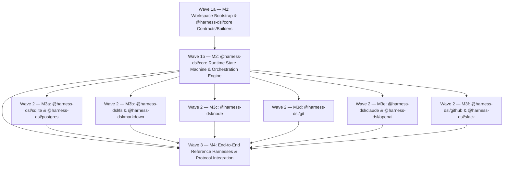

# @harness-dsl Master Implementation Plan Index

## 1. Architectural Overview & Specification Grounding

This plan specifies the complete implementation of the `@harness-dsl` framework and ecosystem across its core orchestration runtime (`@harness-dsl/core`), environment and vendor adapter packages (`@harness-dsl/sqlite`, `@harness-dsl/postgres`, `@harness-dsl/fs`, `@harness-dsl/markdown`, `@harness-dsl/node`, `@harness-dsl/git`, `@harness-dsl/claude`, `@harness-dsl/openai`, `@harness-dsl/github`, `@harness-dsl/slack`), domain test adapters (`@harness-dsl/stripe`, `@harness-dsl/netsuite`), and full production reference harnesses (`packages/integration`).

All milestone specifications are grounded in:

- [`docs/SPEC.md`](file:///Users/torniketsomaia/projects/metaharness/docs/SPEC.md) (lines 1–1583): `@harness-dsl` Framework & Ecosystem Specification (V7)
- [`docs/CODING_SAMPLE.md`](file:///Users/torniketsomaia/projects/metaharness/docs/CODING_SAMPLE.md) (lines 1–1208): Coding Workflow Application Harness Specification (`acme-engineering` V7)
- [`CLAUDE.MD`](file:///Users/torniketsomaia/projects/metaharness/CLAUDE.MD) (lines 1–36): Repository engineering rules and operational invariants

---

## 2. Monorepo Workspace Layout

The monorepo is managed by `pnpm@10.34.9` on Node.js `>=22.0.0` using a single flat `packages/*` workspace topology.

### 2.1 `pnpm-workspace.yaml`

```yaml
packages:
  - packages/*
```

### 2.2 `tsconfig.base.json`

```json
{
  "compilerOptions": {
    "target": "ES2023",
    "module": "NodeNext",
    "moduleResolution": "NodeNext",
    "lib": ["ES2023"],
    "strict": true,
    "exactOptionalPropertyTypes": false,
    "noUncheckedIndexedAccess": true,
    "noImplicitOverride": true,
    "noFallthroughCasesInSwitch": true,
    "forceConsistentCasingInFileNames": true,
    "skipLibCheck": true,
    "declaration": true,
    "declarationMap": true,
    "sourceMap": true,
    "esModuleInterop": true,
    "resolveJsonModule": true,
    "isolatedModules": true,
    "baseUrl": ".",
    "paths": {
      "@harness-dsl/core": ["packages/core/src/index.ts"],
      "@harness-dsl/sqlite": ["packages/sqlite/src/index.ts"],
      "@harness-dsl/postgres": ["packages/postgres/src/index.ts"],
      "@harness-dsl/fs": ["packages/fs/src/index.ts"],
      "@harness-dsl/markdown": ["packages/markdown/src/index.ts"],
      "@harness-dsl/node": ["packages/node/src/index.ts"],
      "@harness-dsl/git": ["packages/git/src/index.ts"],
      "@harness-dsl/claude": ["packages/claude/src/index.ts"],
      "@harness-dsl/openai": ["packages/openai/src/index.ts"],
      "@harness-dsl/github": ["packages/github/src/index.ts"],
      "@harness-dsl/slack": ["packages/slack/src/index.ts"],
      "@harness-dsl/stripe": ["packages/stripe/src/index.ts"],
      "@harness-dsl/netsuite": ["packages/netsuite/src/index.ts"]
    }
  }
}
```

### 2.3 Package Directory Map

| Package Name | Directory Path | Owning Milestone | Runtime Dependencies |
| :--- | :--- | :--- | :--- |
| `@harness-dsl/core` | `packages/core` | `M1` (Contracts/AST) & `M2` (Runtime) | `zod` |
| `@harness-dsl/sqlite` | `packages/sqlite` | `M3a` | `@harness-dsl/core`, `better-sqlite3`, `zod` |
| `@harness-dsl/postgres` | `packages/postgres` | `M3a` | `@harness-dsl/core`, `zod` |
| `@harness-dsl/fs` | `packages/fs` | `M3b` | `@harness-dsl/core`, `picomatch`, `zod` |
| `@harness-dsl/markdown` | `packages/markdown` | `M3b` | `@harness-dsl/core`, `@harness-dsl/fs`, `picomatch`, `zod` |
| `@harness-dsl/node` | `packages/node` | `M3c` | `@harness-dsl/core`, `zod` |
| `@harness-dsl/git` | `packages/git` | `M3d` | `@harness-dsl/core`, `picomatch`, `zod` |
| `@harness-dsl/claude` | `packages/claude` | `M3e` | `@harness-dsl/core`, `zod` |
| `@harness-dsl/openai` | `packages/openai` | `M3e` | `@harness-dsl/core`, `zod` |
| `@harness-dsl/github` | `packages/github` | `M3f` | `@harness-dsl/core`, `zod` |
| `@harness-dsl/slack` | `packages/slack` | `M3f` | `@harness-dsl/core`, `zod` |
| `@harness-dsl/stripe` | `packages/stripe` | `M4` | `@harness-dsl/core`, `zod` |
| `@harness-dsl/netsuite` | `packages/netsuite` | `M4` | `@harness-dsl/core`, `zod` |
| `@harness-dsl/integration` | `packages/integration` | `M4` | All `@harness-dsl/*` packages, `zod` |

---

## 3. `(b) -> (c)` Builder Execution Topology & Dependency DAG

Execution follows a four-stage `(b) -> (c) -> (b)` wave schedule (`Wave 1a -> Wave 1b -> Wave 2 -> Wave 3`) designed for zero interface drift and zero file contention across parallel builders:

1. **Wave 1a — Sequential Core Spine (`b` — Contracts, Schemas, AST & Builders):**
   - **`M1` (`docs/plan/M1-core-contracts.md`):** Bootstraps the monorepo workspace configuration (`package.json`, `pnpm-workspace.yaml`, `tsconfig.base.json`, and all 14 `packages/*/package.json` + `packages/*/tsconfig.json` manifests with `pnpm install --prefer-offline`), and implements 100% of `@harness-dsl/core` port interfaces, data contracts, Zod schema factories, AST node definitions, JSON-Schema compilation helpers, fluent builder APIs (`H.*`), `registerStepExecutors`, and the initial `packages/core/src/runtime/index.ts` stub.
2. **Wave 1b — Sequential Core Spine (`b` — Runtime State Machine & Orchestration Engine):**
   - **`M2` (`docs/plan/M2-core-runtime.md`, depends on `M1`):** Implements the complete `@harness-dsl/core` runtime orchestration engine in `packages/core/src/runtime/**` and its deterministic runtime unit test suites in `packages/core/test/runtime-*.test.ts`, wiring `registerStepExecutors` into `packages/core/src/runtime/index.ts`.
   - Once `M1 -> M2` both pass their verification gates, `@harness-dsl/core` and all workspace manifests are 100% complete and frozen before Wave 2 begins.
3. **Wave 2 — 6-Way Parallel Adapter Fan-Out (`c` — Scoped Adapters):**
   - **`M3a` through `M3f`** execute in parallel over strictly disjoint package directories (all depending on `M1 -> M2` completing):
     - `M3a`: `packages/sqlite/**` and `packages/postgres/**`
     - `M3b`: `packages/fs/**` and `packages/markdown/**`
     - `M3c`: `packages/node/**`
     - `M3d`: `packages/git/**`
     - `M3e`: `packages/claude/**` and `packages/openai/**`
     - `M3f`: `packages/github/**` and `packages/slack/**`
   - None of `M3a..M3f` may modify root workspace files (`package.json`, `pnpm-workspace.yaml`, `tsconfig.base.json`, `pnpm-lock.yaml`), `packages/core/**`, or any directory outside their assigned package path(s).
   - Cross-milestone adapter imports (`M3x` importing `M3y`) are strictly forbidden. Cross-package structural compatibility (such as `Runner` passed to `fs.codingTools` or `git.commitAndPush`, and `PartitionMap` from `@harness-dsl/core` passed to `git.cowWorktree.checkpointPolicy` or `git.publicSurfaceCrossTester`) is enforced via `@harness-dsl/core` port contracts and structural TypeScript interfaces without compile-time cross-adapter imports.
4. **Wave 3 — End-to-End Integration (`b`):**
   - **`M4` (`docs/plan/M4-integration.md`, depends on `M1`, `M2`, and `M3a..M3f`):** Runs after `M1`, `M2`, and `M3a..M3f` all pass their gates. Implements the non-coding financial domain adapters (`packages/stripe`, `packages/netsuite`), compiles and verifies both complete reference harnesses (`SPEC.md` §5 `financial-harness.ts` and `CODING_SAMPLE.md` §6 `engineering-harness.ts`), and executes the full end-to-end protocol and crash-recovery test suites in `packages/integration`.



---

## 4. Repository Engineering Rules

Every builder executing a milestone in this plan is bound by [`CLAUDE.MD`](file:///Users/torniketsomaia/projects/metaharness/CLAUDE.MD):

1. **Zero Comments in Authored Files:** Write no comments (`//`, `/* */`, `#`, `<!-- -->`) in any file authored (TypeScript source code, tests, YAML, JSON, shell scripts, or markdown docs); keep a tool directive only where a tool strictly requires it.
2. **Strict TypeScript:** All packages compile with `tsc --noEmit` under `strict: true`, `noUncheckedIndexedAccess: true`, and `noImplicitOverride: true`. Never use `@ts-ignore` or `any` where a typed generic or `unknown` narrowing applies.
3. **Surgical Scope Discipline:** Each builder touches only the directories owned by its milestone. No builder reformats or modifies unrelated files, existing `infra/**`, `.claude/**`, or `.agents/**` scripts.
4. **Goal-Driven Deterministic Testing:** Every invariant, failure path, crash-recovery state transition, and wire-protocol edge case specified in the milestone must have a deterministic automated Vitest test case (`vitest run`) that passes with zero external network calls or flaky sleeps.
5. **No Secret Reads:** Never read `.env` or print secret values; all environment variables in `@harness-dsl` are represented symbolically via `H.env(key)` (`EnvRef`) and resolved only at leaf adapter invocation boundaries from an explicit environment map or `process.env`.

---

## 5. Milestone Gate Table

| Milestone | Wave | Plan File | Owned Directories | Spec Grounding | Verification Gate Commands |
| :--- | :--- | :--- | :--- | :--- | :--- |
| **`M1`** | Wave 1a (`b`) | [`docs/plan/M1-core-contracts.md`](file:///Users/torniketsomaia/projects/metaharness/docs/plan/M1-core-contracts.md) | `package.json`, `pnpm-workspace.yaml`, `tsconfig.base.json`, `packages/*/package.json`, `packages/*/tsconfig.json`, `packages/core/src/{ports,schemas,ast,json-schema,builders,index}.ts`, `packages/core/src/runtime/index.ts`, `packages/core/test/builders.test.ts` | `SPEC.md` §1–§2 (1–869), §3.1–§3.10 (873–1361); `CODING_SAMPLE.md` §6 (176–1208) | `pnpm install --prefer-offline && pnpm check:comments && pnpm --filter @harness-dsl/core typecheck && pnpm --filter @harness-dsl/core test` |
| **`M2`** | Wave 1b (`b`) | [`docs/plan/M2-core-runtime.md`](file:///Users/torniketsomaia/projects/metaharness/docs/plan/M2-core-runtime.md) | `packages/core/src/runtime/**`, `packages/core/test/runtime-*.test.ts` | `SPEC.md` §1.2 (25–33), §2.3–§2.7 (149–869), §3.1–§3.10 (873–1361); `CODING_SAMPLE.md` §1 (3–18), §4–§5 (130–173) | `pnpm check:comments && pnpm --filter @harness-dsl/core typecheck && pnpm --filter @harness-dsl/core test` |
| **`M3a`** | Wave 2 (`c`) | [`docs/plan/M3a-sqlite.md`](file:///Users/torniketsomaia/projects/metaharness/docs/plan/M3a-sqlite.md) | `packages/sqlite/**`, `packages/postgres/**` | `SPEC.md` §1.1 (20–21), §1.2 (31), §2.6 (430–829), §3.3 (949–960), §3.4.1 (963–990), §3.10 (1342–1361), §4.5 (1465–1471); `CODING_SAMPLE.md` §6 (344–355, 457–475, 554) | `pnpm check:comments && pnpm --filter @harness-dsl/sqlite typecheck && pnpm --filter @harness-dsl/sqlite test && pnpm --filter @harness-dsl/postgres typecheck && pnpm --filter @harness-dsl/postgres test` |
| **`M3b`** | Wave 2 (`c`) | [`docs/plan/M3b-fs-markdown.md`](file:///Users/torniketsomaia/projects/metaharness/docs/plan/M3b-fs-markdown.md) | `packages/fs/**`, `packages/markdown/**` | `SPEC.md` §1.1 (17, 19), §1.2 (31–32), §2.1–§2.3 (46–197), §2.6 (780–829), §3.4 (961–1030), §4.3 (1385–1400), §4.5 (1465–1468); `CODING_SAMPLE.md` §2 (21–101), §3.1 (106–115), §6 (477–636) | `pnpm check:comments && pnpm --filter @harness-dsl/fs typecheck && pnpm --filter @harness-dsl/fs test && pnpm --filter @harness-dsl/markdown typecheck && pnpm --filter @harness-dsl/markdown test` |
| **`M3c`** | Wave 2 (`c`) | [`docs/plan/M3c-node.md`](file:///Users/torniketsomaia/projects/metaharness/docs/plan/M3c-node.md) | `packages/node/**` | `SPEC.md` §1.1 (16), §2.3 (149–220), §2.7 (860–868), §3.4.2 (992–1003), §3.5 (1045–1051), §4.2 (1375–1384); `CODING_SAMPLE.md` §6 (322, 367–430, 504–511, 1002–1031, 1204–1207) | `pnpm check:comments && pnpm --filter @harness-dsl/node typecheck && pnpm --filter @harness-dsl/node test` |
| **`M3d`** | Wave 2 (`c`) | [`docs/plan/M3d-git.md`](file:///Users/torniketsomaia/projects/metaharness/docs/plan/M3d-git.md) | `packages/git/**` | `SPEC.md` §1.1 (18), §2.2 (135–147), §2.4 (223–305), §3.7.2 (1088–1277), §4.4 (1401–1464); `CODING_SAMPLE.md` §3.2 (116–127), §6 (492–530, 715–718, 854, 909, 987–1001) | `pnpm check:comments && pnpm --filter @harness-dsl/git typecheck && pnpm --filter @harness-dsl/git test` |
| **`M3e`** | Wave 2 (`c`) | [`docs/plan/M3e-drivers.md`](file:///Users/torniketsomaia/projects/metaharness/docs/plan/M3e-drivers.md) | `packages/claude/**`, `packages/openai/**` | `SPEC.md` §1.1 (14–15), §2.5 (307–428), §3.2 (881–948), §3.4.2 (998–1003), §3.5 (1063–1067), §3.8 (1290), §4.1 (1366–1374); `CODING_SAMPLE.md` §6 (324–343) | `pnpm check:comments && pnpm --filter @harness-dsl/claude typecheck && pnpm --filter @harness-dsl/claude test && pnpm --filter @harness-dsl/openai typecheck && pnpm --filter @harness-dsl/openai test` |
| **`M3f`** | Wave 2 (`c`) | [`docs/plan/M3f-connectors.md`](file:///Users/torniketsomaia/projects/metaharness/docs/plan/M3f-connectors.md) | `packages/github/**`, `packages/slack/**` | `SPEC.md` §1.1 (22–23), §2.7 (831–868), §3.1 (875–880), §3.6 (1069–1072), §4.5 (1465–1471); `CODING_SAMPLE.md` §6 (356–365, 431–452, 1132–1170, 1204–1207) | `pnpm check:comments && pnpm --filter @harness-dsl/github typecheck && pnpm --filter @harness-dsl/github test && pnpm --filter @harness-dsl/slack typecheck && pnpm --filter @harness-dsl/slack test` |
| **`M4`** | Wave 3 (`b`) | [`docs/plan/M4-integration.md`](file:///Users/torniketsomaia/projects/metaharness/docs/plan/M4-integration.md) | `packages/stripe/**`, `packages/netsuite/**`, `packages/integration/**` | `SPEC.md` §1–§5 (1–1583); `CODING_SAMPLE.md` §1–§6 (1–1208) | `pnpm check:comments && pnpm --filter @harness-dsl/stripe typecheck && pnpm --filter @harness-dsl/netsuite typecheck && pnpm --filter @harness-dsl/integration typecheck && pnpm --filter @harness-dsl/integration test && pnpm -r typecheck && pnpm -r test` |
