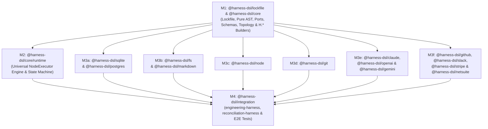

# MetaHarness (`@harness-dsl/*`) — Master Implementation Plan Index

This directory contains the self-contained milestone plans for building and verifying the MetaHarness TypeScript monorepo (`@harness-dsl/*`) against [`docs/SPEC.md`](file:///Users/torniketsomaia/projects/metaharness/docs/SPEC.md) (`lines 1–3324`), [`docs/CODING_SAMPLE.md`](file:///Users/torniketsomaia/projects/metaharness/docs/CODING_SAMPLE.md) (`lines 1–1208`), [`CLAUDE.MD`](file:///Users/torniketsomaia/projects/metaharness/CLAUDE.MD), and [`docs/CODING_GUIDELINES.md`](file:///Users/torniketsomaia/projects/metaharness/docs/CODING_GUIDELINES.md) (§§1–6).

Each milestone file is designed to be handed directly to an isolated **Builder Subagent** (and verified by **Reviewer** and **Verifier** subagents) with bounded context reads: a subagent only needs its mandatory Turn-1 bootstrap manifest (`CLAUDE.MD`, `docs/rules/{GENERAL,BUILDER}.md`, `docs/lessons/{GENERAL,BUILDER}.md`, `docs/CODING_GUIDELINES.md`), its single assigned `docs/plan/M*.md` file, and the exact `docs/SPEC.md` / `docs/CODING_SAMPLE.md` line ranges cited in §2 of that milestone file.

---

## 1. Package Topology & Dependency Graph

Every adapter package (`@harness-dsl/sqlite`, `@harness-dsl/postgres`, `@harness-dsl/fs`, `@harness-dsl/markdown`, `@harness-dsl/node`, `@harness-dsl/git`, `@harness-dsl/claude`, `@harness-dsl/openai`, `@harness-dsl/gemini`, `@harness-dsl/github`, `@harness-dsl/slack`, `@harness-dsl/stripe`, `@harness-dsl/netsuite`) depends on `@harness-dsl/core` (`workspace:*`) (with `@harness-dsl/fs` and `@harness-dsl/git` also consuming the standalone `@harness-dsl/lockfile` utility package). Cross-adapter imports are strictly forbidden (`docs/SPEC.md` §1.1, `docs/CODING_SAMPLE.md` §2).

---

## 2. Milestone Execution Topology: `(b) -> (c) -> (b)`

### Wave 1a — Sequential Core Contracts (`M1`, Topology `b`)
- **[M1-core-contracts.md](./M1-core-contracts.md)**: Bootstraps workspace manifests, builds `@harness-dsl/lockfile` (`packages/lockfile/{src,test}/**`), and builds `@harness-dsl/core` (`packages/core/src/{ast,ports,schemas,topology,builders}/**`, `packages/core/src/h-namespace-contract.ts`, `packages/core/src/h-namespace.ts`, `packages/core/src/index.ts`, and initial `packages/core/src/runtime/index.ts`):
  - Standalone cross-process advisory lockfile utility (`@harness-dsl/lockfile` exporting `withFileLock` and `FileLockOptions` with `p-queue` per-path in-process serialization, atomic `open(lockPath, 'wx')`, `.unref()`ed `utimes` heartbeat, and dead-PID / stale-`mtime` reclamation).
  - Pure passive discriminated-union AST foundation (`ASTNode`, `AstBuilder<TNode>`, `MaybeBuilder<TNode>`, `extractAST`, `EnvRef`, `CoreASTNode`, `DomainASTNode`, `CustomDomainASTRegistry`, and all base/domain AST interfaces from `SPEC.md` §§2.1–2.2 & §§4.1–4.5).
  - Universal `NodeExecutor`, `RuntimeExecutorRegistry`, `createExecutorRegistry`, `IsolationScope` (`'scope'`), `CheckpointableScope` (`'checkpointable'`), `BranchableScope` (`'branchable'`), `ModelDriver`, `LedgerStore`, `TopologyStore`, `LessonStore`, `TrackerAdapter`, `StreamSource`, `HumanAdapter`, and `ControlPlaneAdapter` ports (`SPEC.md` §§2.3–2.8).
  - Schemas (`ScopePredicateSchema`, `GlobalRuleSchema`, `ScopedRuleSchema`, `BudgetApprovalSchema`, `ResumeForkInputSchema`, `SpeculationCandidateSchema`, `SpeculationInputSchema`, `zodToJsonSchema` via `zod` v4 `z.toJSONSchema()`) and topology DAG queries (`dependentsOf`, `affectedBy` via `@dagrejs/graphlib`).
  - All fluent `H.*` builders (`H.env`, `H.signal`, `H.interrupt`, `H.stream`, `H.pool`, `H.prefixGroup`, `H.topology`, `H.rules`, `H.scopedRule`, `H.skill`, `H.lessons`, `H.policy`, `H.human`, `H.command`, `H.agent`, `H.loop`, `H.flow`, `H.lane`, `H.harness`) with static build-time validation of `capabilityTier`, `effectTracking`, `interactionMode`, `.withTools()` canonical `roleKey` derivation, and `.withPolicy()` interrupt handler preservation.

### Wave 1b — Sequential Core Runtime Engine (`M2`, Topology `b`)
- **[M2-core-runtime.md](./M2-core-runtime.md)**: Builds `@harness-dsl/core/runtime` (`packages/core/src/runtime/**`, `packages/core/src/runtime/index.ts`, `packages/core/test/runtime-*.test.ts`, and runtime re-exports in `packages/core/src/index.ts`) once M1 passes its gate:
  - `ScopeLockManager` (shared-read vs exclusive-write handle locks), `StepContinuationQueue` (per-`stepExecId` FIFO serialization), `PoolManager` (run-sticky seat affinity, `429` failover, `escalate-on-retry`), and `ServiceSessionRegistry` (reference-counted daemons across `activeSkillIds`, step-boundary quiescing, pre-drain re-acquisition with `[SERVICE_REACQUIRED]`).
  - Run-immutable `CompiledWirePrefix` compilation, in-run `updatedGroundingDiffs`, Turn-0 `[ROLE_AND_SCOPE_CONTEXT]` frames, and `H.lessons` scoring/distillation/retirement.
  - Two-phase policy guard evaluation (`'deny-with-error'` before `'raise-interrupt'`, multi-call pre-flight batching, post-flight `effectTracking: 'subprocess-post-flight'` sandboxing with `inFlightPreToolCheckpoint` rollback, declaration-ordered `remainingCalls` replay, nested `.adjudicateWith()` outer lease attachment, and 4-step `.onLimitExceeded()` epistemic flush).
  - `executeAgent`, `executeLoop`, `executeCommand`, `executeStepNode`, `executeFlow`, `LaneScheduler`, and `createRuntime`: downward `.fork()` (with conflict-bounce retry loop), speculative `.speculate()` (Post-Race Cases 1–4, `PARKED_ON_ESCALATION`, `refineWinnerWhen`, non-destructive `unpark-escalation`), dynamic `.mutatePlan()` (linear prerequisite chaining, `suspend-and-yield-slot`, replay-idempotent `syncRoot`), and upward `.onChildInterrupt()` + `resumeFork` (Cases A/B/C and recursive epoch resolution).

### Wave 2 — Parallel Adapter Fan-Out (`M3a`–`M3f`, Topology `c`)
All 6 adapter milestones depend **only** on `@harness-dsl/core` from M1 and touch strictly disjoint `packages/<adapter>/**` directories:
- **[M3a-sqlite.md](./M3a-sqlite.md)**: `@harness-dsl/sqlite` (`packages/sqlite/**`) and `@harness-dsl/postgres` (`packages/postgres/**`).
- **[M3b-fs-markdown.md](./M3b-fs-markdown.md)**: `@harness-dsl/fs` (`packages/fs/**`) and `@harness-dsl/markdown` (`packages/markdown/**`).
- **[M3c-node.md](./M3c-node.md)**: `@harness-dsl/node` (`packages/node/**`).
- **[M3d-git.md](./M3d-git.md)**: `@harness-dsl/git` (`packages/git/**`).
- **[M3e-drivers.md](./M3e-drivers.md)**: `@harness-dsl/claude` (`packages/claude/**`), `@harness-dsl/openai` (`packages/openai/**`), and `@harness-dsl/gemini` (`packages/gemini/**`).
- **[M3f-connectors.md](./M3f-connectors.md)**: `@harness-dsl/github` (`packages/github/**`), `@harness-dsl/slack` (`packages/slack/**`), `@harness-dsl/stripe` (`packages/stripe/**`), and `@harness-dsl/netsuite` (`packages/netsuite/**`).

### Wave 3 — End-to-End Reference Harnesses & Integration Verification (`M4`, Topology `b`)
- **[M4-integration.md](./M4-integration.md)**: Builds `@harness-dsl/integration` (`packages/integration/**`), compiling and testing both the complete `engineering-harness` reference implementation (`CODING_SAMPLE.md` §6) and the non-coding financial `reconciliation-harness` (`SPEC.md` §5) end-to-end across all `@harness-dsl/*` packages.

---

## 3. File & Directory Ownership Matrix

| Milestone | Owned Directories (`owned_dirs` — Read/Write) | Forbidden Directories (`forbidden_dirs` — Zero Touch) |
| :--- | :--- | :--- |
| **M1** | `pnpm-workspace.yaml`, `packages/*/{package.json,tsconfig.json}`, `packages/lockfile/**`, `packages/core/src/{ast,ports,schemas,topology,builders}/**`, `packages/core/src/h-namespace-contract.ts`, `packages/core/src/h-namespace.ts`, `packages/core/src/index.ts`, `packages/core/src/runtime/index.ts`, `packages/core/test/{fixtures,ast-and-schemas.test.ts,topology-and-builders.test.ts,flow-and-validation.test.ts}` | `packages/core/src/runtime/**` (except `runtime/index.ts`), `packages/{sqlite,postgres,fs,markdown,node,git,claude,openai,gemini,github,slack,stripe,netsuite,integration}/{src,test}/**`, `package.json`, `eslint.config.mjs`, `tsconfig.base.json`, `vitest.config.ts`, `.agents/**`, `.claude/**`, `docs/**` |
| **M2** | `packages/core/src/runtime/**`, `packages/core/src/runtime/index.ts`, `packages/core/src/index.ts` (runtime re-exports), `packages/core/test/fixtures/**`, `packages/core/test/runtime-*.test.ts` (5 subsystem test files) | `packages/core/src/{ast,ports,schemas,topology,builders}/**`, `packages/core/src/h-namespace*.ts`, all adapter packages, `packages/integration/**`, root configs, `.agents/**`, `.claude/**`, `docs/**` |
| **M3a** | `packages/sqlite/{src,test}/**`, `packages/postgres/{src,test}/**` | `packages/core/**`, all other `packages/*/**`, root configs, `.agents/**`, `.claude/**`, `docs/**` |
| **M3b** | `packages/fs/{src,test}/**`, `packages/markdown/{src,test}/**` | `packages/core/**`, all other `packages/*/**`, root configs, `.agents/**`, `.claude/**`, `docs/**` |
| **M3c** | `packages/node/{src,test}/**` | `packages/core/**`, all other `packages/*/**`, root configs, `.agents/**`, `.claude/**`, `docs/**` |
| **M3d** | `packages/git/{src,test}/**` | `packages/core/**`, all other `packages/*/**`, root configs, `.agents/**`, `.claude/**`, `docs/**` |
| **M3e** | `packages/claude/{src,test}/**`, `packages/openai/{src,test}/**`, `packages/gemini/{src,test}/**` | `packages/core/**`, all other `packages/*/**`, root configs, `.agents/**`, `.claude/**`, `docs/**` |
| **M3f** | `packages/github/{src,test}/**`, `packages/slack/{src,test}/**`, `packages/stripe/{src,test}/**`, `packages/netsuite/{src,test}/**` | `packages/core/**`, all other `packages/*/**`, root configs, `.agents/**`, `.claude/**`, `docs/**` |
| **M4** | `packages/integration/{src,test}/**` | `packages/core/**`, all adapter `packages/*/**`, root configs, `.agents/**`, `.claude/**`, `docs/**` |

---

## 4. Global Invariants for All Subagents

1. **Pure AST & Late Binding (`docs/SPEC.md` §1.1–§1.2, `docs/CODING_GUIDELINES.md` Rule 5.2):**
   - Every builder method and `.toAST()` call must be 100% side-effect-free (zero filesystem, network, subprocess, or database I/O at import or builder time) and return deeply frozen (`Object.freeze`) monomorphic AST objects (`docs/CODING_GUIDELINES.md` Rule 4.3).
2. **Explicit Capabilities & Symbolic `EnvRef` (`docs/SPEC.md` §1.2, `docs/CODING_GUIDELINES.md` Rule 5.2):**
   - Never read `.env` or evaluate `process.env` at module import or builder time. Secrets and environment-dependent values are represented symbolically via `H.env('KEY')` (`EnvRef`) in AST definitions and resolved exclusively at leaf adapter execution time via `ctx.resolveEnv`.
3. **Strict File Separation & Module Taxonomy (`docs/CODING_GUIDELINES.md` §1 & Rule 3.3):**
   - **Single-kind entity files (`Rule 1.1`):** Unrelated or different-kind declarations (`interface`, `type`, `class`, `function`, `const`) must **never** share a production file (`src/**`, `test/fixtures/**`), enforced by `harness/file-separation` (Rules 1.2–1.7):
     1. **`*.types.ts`**: pure `type` aliases (discriminated unions, primitive/template-literal/mapped/conditional types);
     2. **`*.schema.ts`**: Zod schema `export const FooSchema = z.object(...)` paired with its inferred `export type Foo = z.infer<typeof FooSchema>`;
     3. **`<entity-name>.ts` (`Rule 1.2`)**: 1 root `interface` + secondary sub-interfaces reachable from the root interface via **`TSPropertySignature`, `TSIndexSignature`, `extends`, or `TSMethodSignature` parameter/return types** (such as fluent callback sub-builders `$d`, `$r`, `$t`, `$f`, `$s`, `$intr`, `$b`, `$c`, `$m`, `$l` and dedicated port method parameter/return interfaces), while keeping every file `<= 250` lines;
     4. **`<class-name>.ts` (`Rule 1.3`)**: 1 `class` + optional dedicated 1:1 `*Params` / `*Options` parameter interfaces (and their reachable sub-interfaces);
     5. **`create-*-builder.ts` / `<domain-verb>.ts` / `internal/<domain-verb>.ts` (`Rule 1.6` & `Rule 3.3`)**: functions + optional dedicated 1:1 `*Params` / `*Options` parameter interfaces (and their reachable sub-interfaces; shared multi-caller `*Params` / `*Options` interfaces live in their own dedicated interface file): at most `1` top-level function in `**/builders/*.ts`, `**/create-*.ts` outside `internal/`, or any file with a function `> 40` lines; up to `4` cohesive functions (`<= 40` lines each) in `internal/`;
     6. **`*.constants.ts` & `index.ts` (`Rules 1.5 & 1.7`)**: `const` values only in `*.constants.ts` (and namespace facade `const` in `*-namespace.ts` separated from its `*-namespace-contract.ts` interface); pure explicit re-exports in `index.ts` (zero declarations and zero wildcard `export *`).
   - **Universal line ceilings:** Every non-test file (`src/**`, `test/fixtures/**`, `scripts/**`, `.agents/hooks/**`, `eslint.config.mjs`) must be **`<= 250` lines**; every test file (`test/**/*.test.ts`) must be **`<= 400` lines**.
   - **Strict DAG imports & 1:1 naming (`Rules 1.7 & 1.8`):** Leaf files import directly from sibling leaf files (never back through `index.js`), and grab-bag file names (`utils.ts`, `helpers.ts`, `common.ts`, `shared.ts`, `misc.ts`, `core.ts`, `base.ts`, unprefixed `types.ts` / `constants.ts` / `schemas.ts`) are forbidden.
4. **Mandatory JSDoc Anatomy & Zero Inline Comments (`CLAUDE.MD`, `docs/CODING_GUIDELINES.md` §2):**
   - **Every declaration documented (`Rule 2.1`):** Every `class` (and its constructor, methods, and properties), `interface` (and its properties and methods), `function` (public, `internal/`, and CLI hook/script functions), and top-level `type` alias or `const` in `src/**`, `test/fixtures/**`, `scripts/**`, `.agents/hooks/**`, and `eslint.config.mjs` requires a `/** ... */` JSDoc block immediately above its declaration.
   - **3-part JSDoc anatomy & tag rules (`Rule 2.2`):**
     - Every `class`, top-level `interface`, public `function` (or `internal/` function `> 20` lines), non-`private` class method (`MethodDefinition`), and interface method (`TSMethodSignature`) requires the 3-part JSDoc anatomy: (1) 1-sentence summary line, (2) detailed description paragraph separated by an empty `*` line, and (3) grouped block tags (`@template TName Description`, `@param {Type} name - Description` with `[name=default]` when optional, `@returns {Type} Description` for non-`void` callables, `@throws {ErrorType} Description`, and `@note` / `@example` where applicable; **vertical ASCII column alignment of `@template` and `@param` tags is not required**).
     - `private` class methods and small `internal/` helper functions (`<= 20` lines) require only a 1-paragraph summary + required `@tags` (`@template`, `@param`, `@returns`, `@throws`). Properties, top-level constants, and simple type aliases may use a 1-sentence `/** Summary. */` unless `@template` tags or invariants require detail (1-line stub JSDocs on interface methods are rejected by `harness/require-complete-jsdoc`).
   - **Zero inline or non-JSDoc comments (`Rule 2.4`):** Write **zero inline or non-JSDoc comments** (single-line slash comments, non-JSDoc block comments, hash comments, or HTML comments) in any file, and **zero comments of any kind** inside a function, method, or constructor body.
5. **Clean Code, Library-First Mandate, Runtime Performance & Type Rigor (`docs/CODING_GUIDELINES.md` §§3–5):**
   - Keep functions `<= 80` lines with flat guard clauses (max nesting depth `3`) and named `*Params` / `*Options` parameter objects (co-located in the consuming function/class file when dedicated 1:1, placed in a dedicated interface file when shared across modules, or co-located with the parent port/builder interface via `TSMethodSignature`) whenever a function/method/constructor takes `> 3` parameters (`Rules 3.1–3.3`).
   - Enforce the **Library-First Mandate (`Rule 3.5`)**: use the exact Owner-approved libraries mandated in `docs/CODING_GUIDELINES.md` Rule 3.5 and each milestone's §1 **Approved External Libraries & Native Primitives** table rather than hand-rolling commodity utilities.
   - Use single-pass `for` loops (zero array/object spread accumulation in loops, zero `.filter().map().flatMap()` chains in runtime paths) and pre-indexed `Map` / `Set` $O(1)$ lookups; pre-compile `picomatch` globs and `RegExp` instances once at registration (`Rules 4.1–4.4`).
   - Release all acquired resources (leases, worktrees, daemons, child processes, DB transactions, `AbortSignal` listeners) inside `try / finally` (`Rule 5.3`).
   - Zero `: any`, `as any`, `as unknown as T`, unguarded `!` non-null assertions, or `@ts-ignore` / `@ts-expect-error` / `@ts-nocheck` directives in `src/**` or `test/**` (`Rule 5.1`).
6. **Real-Resource Deterministic Testing (`docs/CODING_GUIDELINES.md` §6):**
   - Organize tests per subsystem (`<= 400` lines per `test/*.test.ts`), placing shared fakes/fixtures in `test/fixtures/` (`<= 250` lines per file, obeying strict single-entity-kind file separation and §2 JSDoc).
   - Test against real local SQLite databases, real `PGlite` PostgreSQL instances, real Git repositories/worktrees, real temporary directories, and real Node child processes/PTY daemons; coordinate concurrency with deterministic barrier latches (zero `setTimeout` sleeps) and assert exact structural outputs and error messages.

---

## 5. Milestone Summary & Scoped Gate Commands

Every milestone gate runs its scoped `lint`, `typecheck`, and `vitest` commands (and `pnpm lint && pnpm typecheck && pnpm test` at wave barriers) plus `test -z "$(git status --porcelain -- docs .agents .claude package.json tsconfig.base.json vitest.config.ts)"` (along with the `docs/IMPL_LOOP.md` `baseline_dirty` check verifying zero new or newly modified files in `<non_sibling_forbidden_dirs_excluding_upstream_patches>` relative to `baseline_dirty` so uncommitted `M1`/`M2` files and concurrent Wave-2 sibling adapters never cause false gate failures).

| Milestone | Plan File | Target Packages | Scoped Verification Gate Commands |
| :--- | :--- | :--- | :--- |
| **M1** | [`docs/plan/M1-core-contracts.md`](./M1-core-contracts.md) | `@harness-dsl/lockfile`, `@harness-dsl/core` *(Lockfile, Pure AST, Ports, Schemas, Topology & `H.*` Builders)* | `pnpm --filter @harness-dsl/lockfile --filter @harness-dsl/core lint && pnpm --filter @harness-dsl/lockfile --filter @harness-dsl/core typecheck && pnpm --filter @harness-dsl/lockfile --filter @harness-dsl/core test -- --reporter=verbose && test -z "$(git status --porcelain -- docs .agents .claude package.json tsconfig.base.json vitest.config.ts)"` |
| **M2** | [`docs/plan/M2-core-runtime.md`](./M2-core-runtime.md) | `@harness-dsl/core` *(Runtime Engine & State Machine)* | `pnpm --filter @harness-dsl/core lint && pnpm --filter @harness-dsl/core typecheck && pnpm --filter @harness-dsl/core test -- --reporter=verbose && test -z "$(git status --porcelain -- docs .agents .claude package.json tsconfig.base.json vitest.config.ts)"` |
| **M3a** | [`docs/plan/M3a-sqlite.md`](./M3a-sqlite.md) | `@harness-dsl/sqlite`, `@harness-dsl/postgres` | `pnpm --filter @harness-dsl/sqlite --filter @harness-dsl/postgres lint && pnpm --filter @harness-dsl/sqlite --filter @harness-dsl/postgres typecheck && pnpm --filter @harness-dsl/sqlite --filter @harness-dsl/postgres test -- --reporter=verbose && test -z "$(git status --porcelain -- docs .agents .claude package.json tsconfig.base.json vitest.config.ts)"` |
| **M3b** | [`docs/plan/M3b-fs-markdown.md`](./M3b-fs-markdown.md) | `@harness-dsl/fs`, `@harness-dsl/markdown` | `pnpm --filter @harness-dsl/fs --filter @harness-dsl/markdown lint && pnpm --filter @harness-dsl/fs --filter @harness-dsl/markdown typecheck && pnpm --filter @harness-dsl/fs --filter @harness-dsl/markdown test -- --reporter=verbose && test -z "$(git status --porcelain -- docs .agents .claude package.json tsconfig.base.json vitest.config.ts)"` |
| **M3c** | [`docs/plan/M3c-node.md`](./M3c-node.md) | `@harness-dsl/node` | `pnpm --filter @harness-dsl/node lint && pnpm --filter @harness-dsl/node typecheck && pnpm --filter @harness-dsl/node test -- --reporter=verbose && test -z "$(git status --porcelain -- docs .agents .claude package.json tsconfig.base.json vitest.config.ts)"` |
| **M3d** | [`docs/plan/M3d-git.md`](./M3d-git.md) | `@harness-dsl/git` | `pnpm --filter @harness-dsl/git lint && pnpm --filter @harness-dsl/git typecheck && pnpm --filter @harness-dsl/git test -- --reporter=verbose && test -z "$(git status --porcelain -- docs .agents .claude package.json tsconfig.base.json vitest.config.ts)"` |
| **M3e** | [`docs/plan/M3e-drivers.md`](./M3e-drivers.md) | `@harness-dsl/claude`, `@harness-dsl/openai`, `@harness-dsl/gemini` | `pnpm --filter @harness-dsl/claude --filter @harness-dsl/openai --filter @harness-dsl/gemini lint && pnpm --filter @harness-dsl/claude --filter @harness-dsl/openai --filter @harness-dsl/gemini typecheck && pnpm --filter @harness-dsl/claude --filter @harness-dsl/openai --filter @harness-dsl/gemini test -- --reporter=verbose && test -z "$(git status --porcelain -- docs .agents .claude package.json tsconfig.base.json vitest.config.ts)"` |
| **M3f** | [`docs/plan/M3f-connectors.md`](./M3f-connectors.md) | `@harness-dsl/github`, `@harness-dsl/slack`, `@harness-dsl/stripe`, `@harness-dsl/netsuite` | `pnpm --filter @harness-dsl/github --filter @harness-dsl/slack --filter @harness-dsl/stripe --filter @harness-dsl/netsuite lint && pnpm --filter @harness-dsl/github --filter @harness-dsl/slack --filter @harness-dsl/stripe --filter @harness-dsl/netsuite typecheck && pnpm --filter @harness-dsl/github --filter @harness-dsl/slack --filter @harness-dsl/stripe --filter @harness-dsl/netsuite test -- --reporter=verbose && test -z "$(git status --porcelain -- docs .agents .claude package.json tsconfig.base.json vitest.config.ts)"` |
| **M4** | [`docs/plan/M4-integration.md`](./M4-integration.md) | `@harness-dsl/integration` *(Full Workspace E2E)* | `pnpm --filter @harness-dsl/integration lint && pnpm --filter @harness-dsl/integration typecheck && pnpm --filter @harness-dsl/integration test -- --reporter=verbose && pnpm lint && pnpm typecheck && pnpm test && test -z "$(git status --porcelain -- docs .agents .claude package.json tsconfig.base.json vitest.config.ts)"` |
